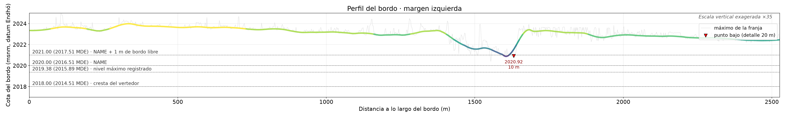
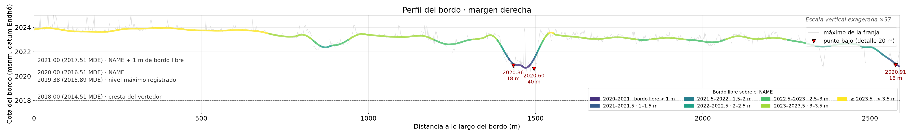
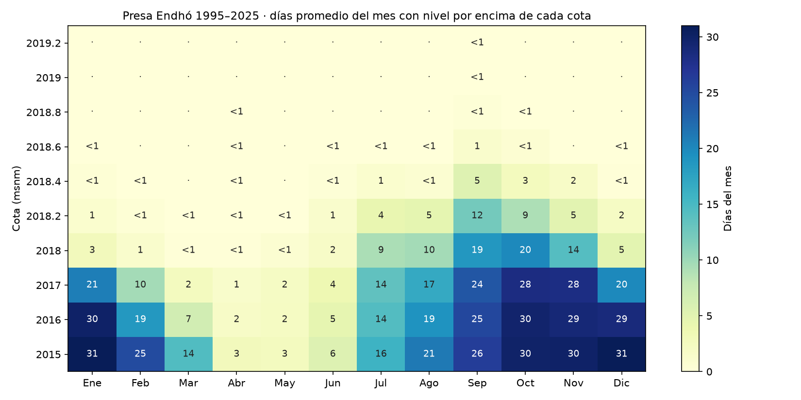
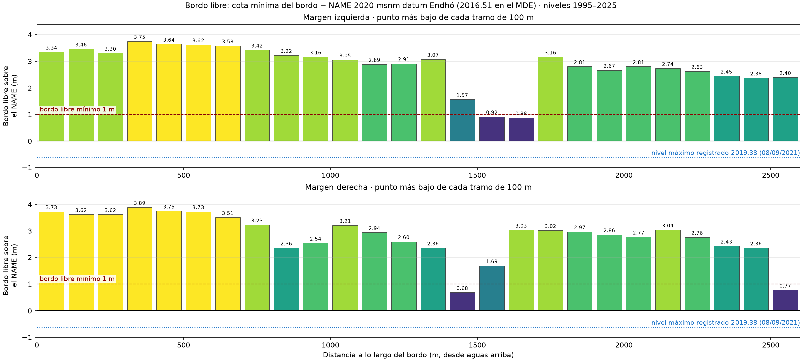
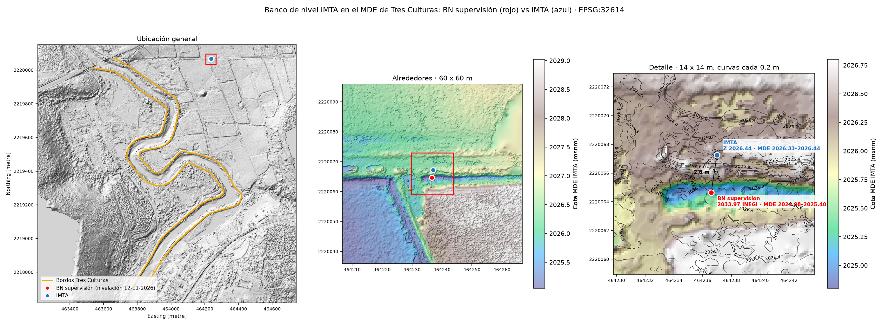

# Bordos Tres Culturas

## Perfiles





## Bordos


## Árboles y edificios


## Temporada por mes



## Bordo libre por tramo



## Tablas

- [Puntos bajos](resultados/puntos_bajos.csv): tramos con bordo libre < 1 m sobre el NAME
- [Resumen por margen](resultados/resumen_por_margen.csv)
- [Temporada por mes](resultados/temporada_por_mes.csv)
- [Bordo libre por tramo](resultados/bordo_libre_por_tramo.csv)

## Archivos

| Archivo | Contenido |
|---|---|
| `datos/bordos.gpkg` | Eje por margen |
| `resultados/bordo_analisis.gpkg` | Bordo por cota, puntos bajos, bordos y obstáculos |
| `estilos/` | Estilos QGIS para el MDT y las capas |
| `gee_obstaculos.py` | Dosel (Meta), NDVI 2025 (Sentinel-2) y edificios (Open Buildings) desde Earth Engine |
| `bordo_analisis.py` | Perfil, frecuencias y puntos bajos; excluye árboles y edificios |
| `temporada_por_mes.py` | Tabla y figura mes × cota |
| `bordo_libre_por_tramo.py` | Bordo libre sobre el NAME del punto más bajo de cada tramo de 100 m |
| `mapa.py` | Mapa del bordo por cota |
| `mapa_obstaculos.py` | Mapa de árboles y edificios sobre y cerca del bordo |
| `banco_imta.py` | Mapa del banco de nivel IMTA en el MDE: punto medido vs punto de Ariel |

## Uso

```
pip install -r requirements.txt
python temporada_por_mes.py niveles_endho.xlsx resultados
python gee_obstaculos.py datos/bordos.gpkg bordo datos <proyecto_gee>
python bordo_analisis.py MDT_27102025.tif niveles_endho.xlsx datos/bordos.gpkg bordo resultados datos/satelite.tif
python bordo_libre_por_tramo.py niveles_endho.xlsx resultados
python mapa.py MDT_27102025.tif resultados/bordo_analisis.gpkg resultados/mapa_bordos.png
python mapa_obstaculos.py MDT_27102025.tif resultados resultados/mapa_obstaculos.png
python banco_imta.py MDT_27102025.tif resultados/bordo_analisis.gpkg resultados/banco_imta_mde.png
```

MDT: `MDT_27102025.tif` (EPSG:32614), modelo de elevación del IMTA. Niveles: registro diario de la presa Endhó 1995–2025.

## Datum

Las cotas del MDT (IMTA) y los niveles de la presa (Endhó) usan bancos de nivel distintos. Ligas topográficas:

| Referencia | Endhó | IMTA | INEGI |
|---|---|---|---|
| Cresta del vertedor | 2018.00 | | 2022.04 |
| Banco IMTA | | 2026.44 | 2033.97 |

INEGI = Endhó + 4.04 = IMTA + 7.53, por lo tanto **Endhó = IMTA + 3.49**. `bordo_analisis.py` suma `IMTA_A_ENDHO = 3.49` al MDT, así que todas las cotas de `resultados/` están en datum Endhó. `mdt_a_puntos.py` exporta el MDT sin ajuste (datum IMTA). La diferencia de 0.09 m entre la regleta y la cresta se desprecia por ahora.

Equivalencias (Endhó → MDE): cresta 2018.00 → 2014.51; nivel máximo registrado 2019.38 → 2015.89; NAME 2020.00 → 2016.51; NAME + 1 m 2021.00 → 2017.51.

## Revisión del banco de nivel IMTA

Nivelación con la supervisión del 12-11-2026 (`12-11-2026_LEV BN ENDHO.xlsx`):

| Punto | E | N | h | Liga |
|---|---|---|---|---|
| Vertedor | 461,765.73 | 2,229,353.26 | 2022.04 | 2022.04 − 2018.00 = 4.04 m |
| ENDHO-01 | 462,469.79 | 2,228,778.53 | 2027.13 | |
| Escala hidrométrica (base) | 462,790.24 | 2,228,728.82 | 2022.23 | |
| Escala hidrométrica (H) | 462,790.18 | 2,228,728.89 | 2023.23 | 2023.23 − 2019.10 = 4.13 m |
| BN IMTA | 464,236.59 | 2,220,064.64 | 2033.97 | |

La liga Endhó–INEGI (≈ 4.04 m) se confirma con el vertedor y la escala.

Cota del MDE en los dos puntos del banco:

| Punto | E | N | Cota de referencia | MDE |
|---|---|---|---|---|
| Punto de Ariel | 464,236.99 | 2,220,067.25 | 2026.44 | 2026.33 en el punto, 2026.44 de mediana en 1 m |
| BN medido 12-11-2026 | 464,236.59 | 2,220,064.64 | 2033.97 INEGI | 2024.98 en el punto, 2025.40 de mediana en 1 m |



- En el punto de Ariel el MDE coincide con 2026.44: hay 0.11 m de diferencia.
- El BN medido está 2.6 m al sur. Ahí pasa un canal de ≈ 1 m de profundidad y el MDE baja a 2025.40. Si se usa ese punto, la liga sería Endhó = MDE + 4.53 (1.04 m más).
- El banco está justo en la orilla del canal: un desplazamiento horizontal de unos decímetros en el MDE cambia la cota hasta 1 m, así que con el MDE solo no se puede decidir.
- **Por ahora se usa 3.49 m**, que cuadra con el NAME en 2016.51 del MDE y es el caso conservador (bordo más bajo). Con 4.53 todo el bordo subiría 1.04 m; en los dos casos queda arriba del NAME.
- Para confirmar: medir con GNSS 2 o 3 puntos en terreno plano dentro del MDE (pavimento, losa, puente). El vertedor y la escala quedan fuera del MDE (llega hasta N 2,223,182).

## Clases y puntos bajos

El bordo se clasifica por **bordo libre sobre el NAME** (2020 msnm, datum Endhó) en pasos de 0.5 m. Un punto bajo es un tramo de al menos 2 m con bordo libre menor a `BORDO_LIBRE_MIN = 1.0` m (cota < 2021.0), medido en el perfil de detalle (20 m).
