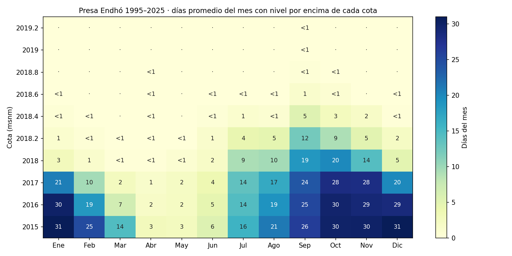
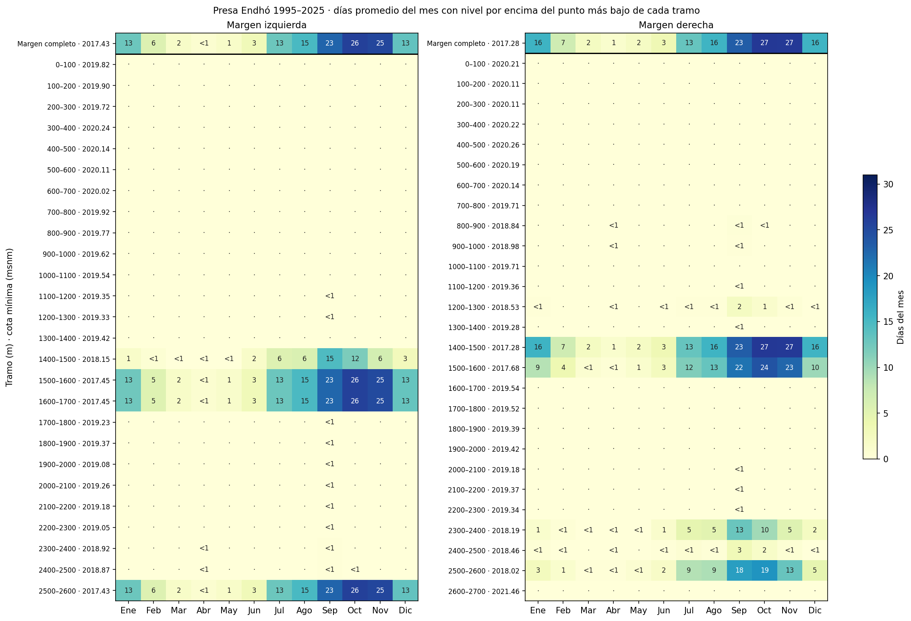
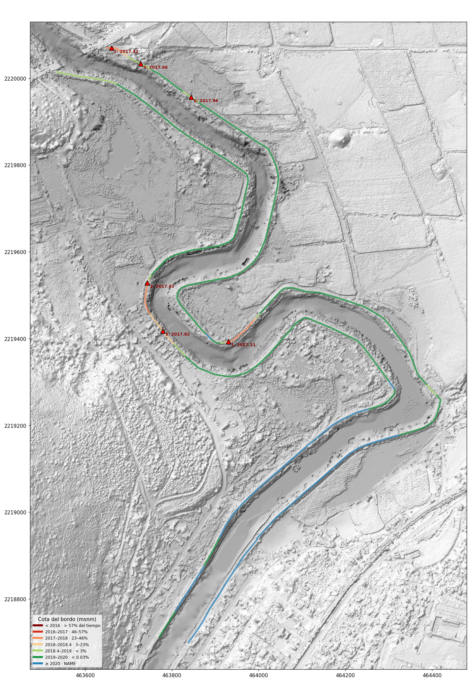
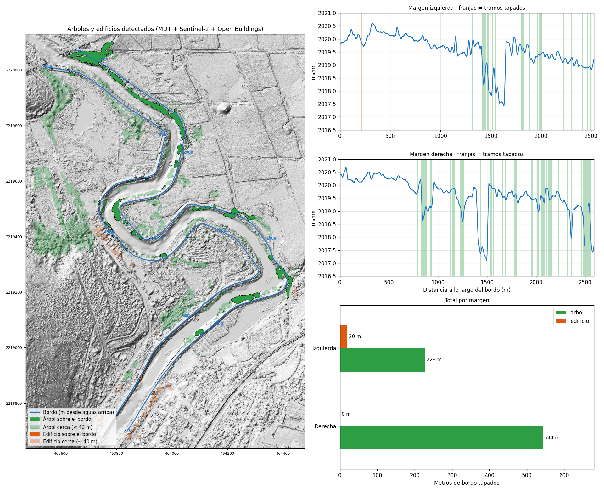
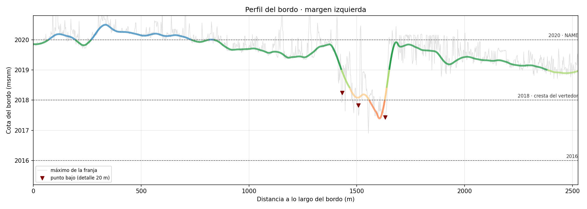
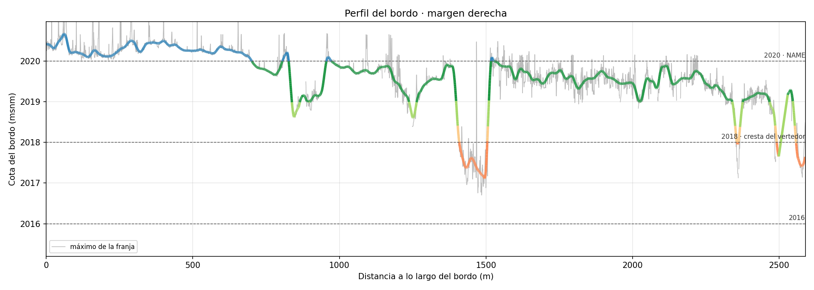

# Bordos Tres Culturas

## Temporada por mes



## Temporada por margen



## Bordos



## Árboles y edificios



## Perfiles





## Tablas

- [Puntos bajos](resultados/puntos_bajos.csv)
- [Resumen por margen](resultados/resumen_por_margen.csv)
- [Temporada por mes](resultados/temporada_por_mes.csv)
- [Temporada por margen](resultados/temporada_por_margen.csv)

## Archivos

| Archivo | Contenido |
|---|---|
| `datos/bordos.gpkg` | Eje por margen |
| `resultados/bordo_analisis.gpkg` | Bordo por cota, puntos bajos, bordos y obstáculos |
| `estilos/` | Estilos QGIS para el MDT y las capas |
| `gee_obstaculos.py` | Dosel (Meta), NDVI 2025 (Sentinel-2) y edificios (Open Buildings) desde Earth Engine |
| `bordo_analisis.py` | Perfil, frecuencias y puntos bajos; excluye árboles y edificios |
| `temporada_por_mes.py` | Tabla y figura mes × cota |
| `temporada_por_margen.py` | Tabla y figura mes × tramo, por margen |
| `mapa.py` | Mapa del bordo por cota |
| `mapa_obstaculos.py` | Mapa de árboles y edificios sobre y cerca del bordo |

## Uso

```
pip install -r requirements.txt
python temporada_por_mes.py niveles_endho.xlsx resultados
python gee_obstaculos.py datos/bordos.gpkg bordo datos <proyecto_gee>
python bordo_analisis.py MDT_27102025.tif niveles_endho.xlsx datos/bordos.gpkg bordo resultados datos/satelite.tif
python temporada_por_margen.py niveles_endho.xlsx resultados
python mapa.py MDT_27102025.tif resultados/bordo_analisis.gpkg resultados/mapa_bordos.png
python mapa_obstaculos.py MDT_27102025.tif resultados resultados/mapa_obstaculos.png
```

MDT: `MDT_27102025.tif` (EPSG:32614). Niveles: registro diario de la presa Endhó 1995–2025.
